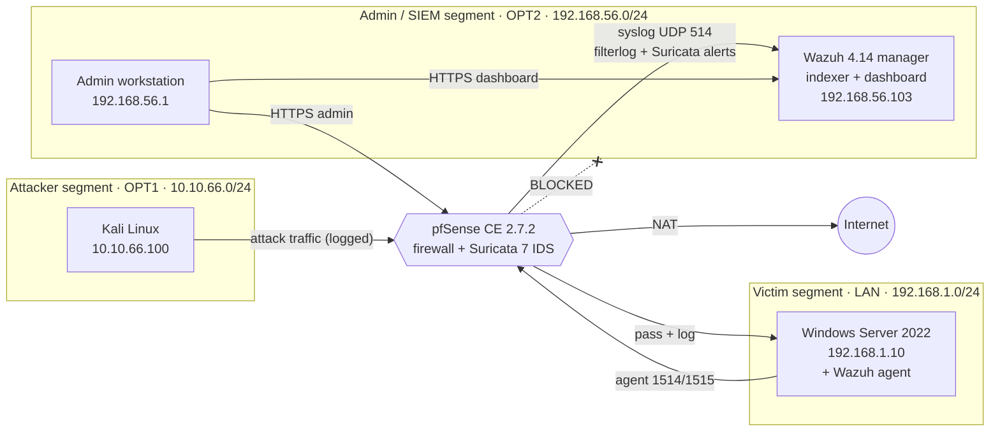
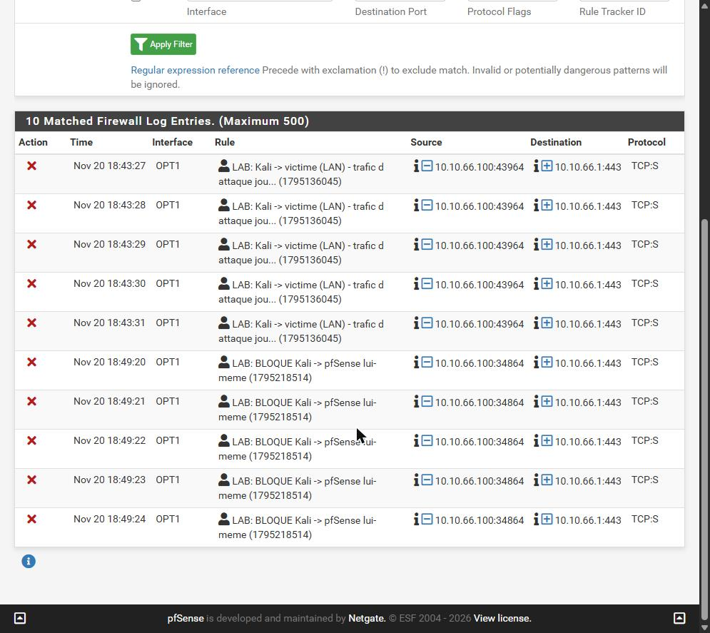
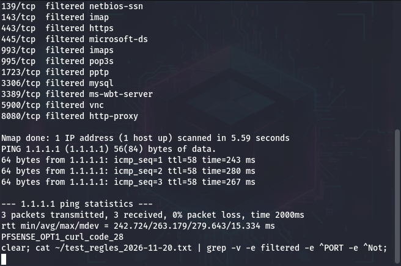
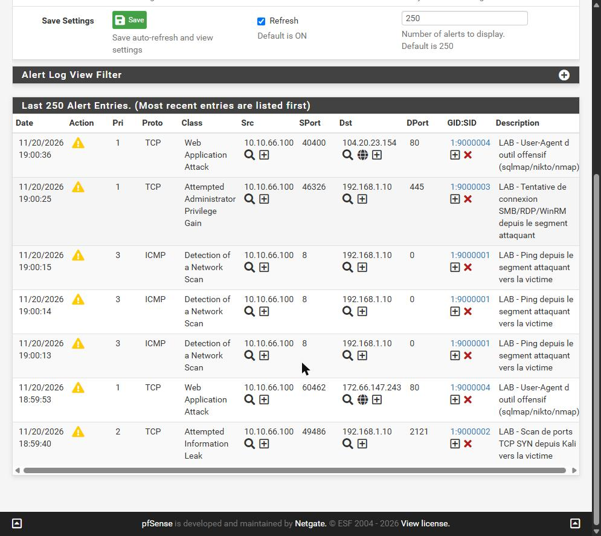
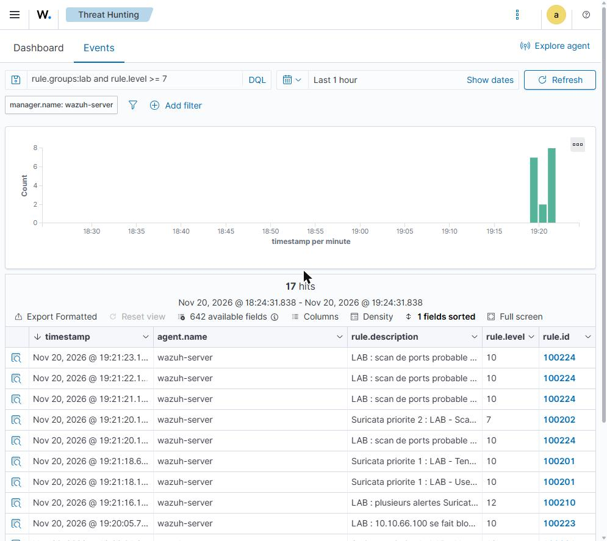
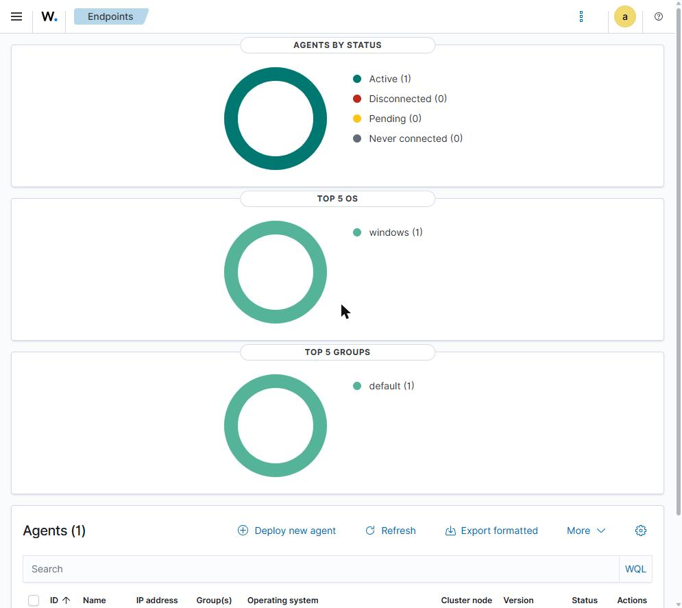
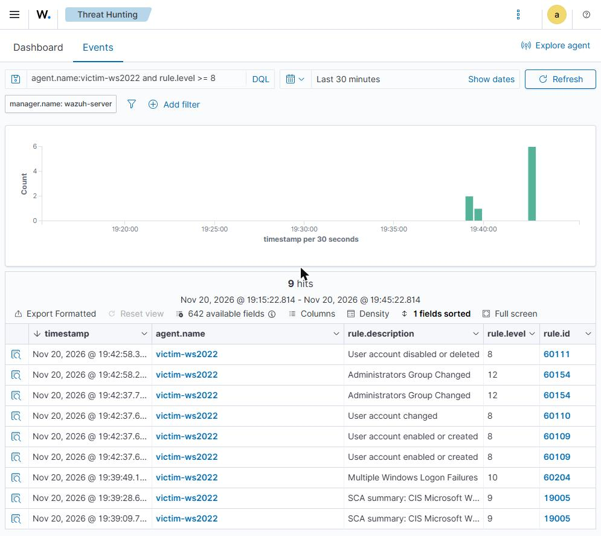

# Firewall + IDS + SIEM Detection Lab (pfSense · Suricata · Wazuh)

A home SOC lab built and **actually executed** end to end: an attacker on an isolated segment,
a segmented firewall, a network IDS with custom signatures, and a SIEM that correlates
network and endpoint telemetry, with every detection mapped to MITRE ATT&CK.

> Everything in this repository was run on real VMs (VirtualBox) in November 2026.
> Screenshots and alert exports in [`evidence/`](evidence/) come from those runs.

---

## Architecture



| Component | Role | Notes |
|-----------|------|-------|
| **pfSense CE 2.7.2** | Firewall / router between 3 segments | 4 NICs: WAN (NAT), LAN, OPT1 (attacker), OPT2 (admin) |
| **Suricata 7.0.8** (pfSense package) | Network IDS on OPT1 | ET Open + Snort GPLv2 Community + 4 custom rules, IDS mode (no blocking) |
| **Wazuh 4.14.10** (official OVA) | SIEM | Receives pfSense/Suricata syslog + Windows agent; custom decoders and rules |
| **Windows Server 2022** (eval) | Victim | Wazuh agent, Windows Security log collection |
| **Kali Linux** | Attacker | Confined to OPT1, cannot reach the admin/SIEM network |

**Design choice:** the SIEM sits on the admin network, which the attacker segment is explicitly
blocked from (firewall rule 2). An attacker who lands on OPT1 cannot tamper with the logs.

---

## Detection matrix

### Network (Kali → victim, seen by pfSense + Suricata, correlated in Wazuh)

| Attack | MITRE | Suricata (custom SID) | Wazuh rule | Level |
|--------|-------|-----------------------|------------|-------|
| ICMP sweep | T1018 | 9000001 | 100203 | 5 |
| TCP port scan | T1046 | 9000002 | 100202 / **100224** (20+ connections in 30 s) | 7 / **10** |
| SMB / RDP / WinRM connection attempt | T1021 | 9000003 | 100201 | **10** |
| Offensive tool User-Agent (sqlmap / nikto / nmap) | T1190 | 9000004 | 100201 | **10** |
| Repeated hits on blocked destinations | T1046 | (pfSense block) | 100221 / **100223** | 5 / **10** |
| Several IDS alerts from one source within 2 min | n/a | n/a | **100210** | **12** |

### Endpoint (on the victim, seen by the Wazuh agent)

| Scenario | MITRE | Windows event | Wazuh rule | Level |
|----------|-------|---------------|------------|-------|
| Brute force: 8 failed logons | T1110 | 4625 | 60122 → **60204** "Multiple Windows Logon Failures" | 5 → **10** |
| New local account created | T1136.001 | 4720 / 4722 | 60109 | 8 |
| Account added to Administrators | T1098 | 4732 | **60154** "Administrators Group Changed" | **12** |
| Cleanup: account deleted | n/a | 4726 / 4733 | 60111 / 60154 | 8 / 12 |

Alert counts from the actual runs: [`evidence/wazuh-alert-summary-network.txt`](evidence/wazuh-alert-summary-network.txt),
[`evidence/wazuh-alert-summary-host.txt`](evidence/wazuh-alert-summary-host.txt).

---

## Repository layout

```
configs/
  pfsense/firewall-rules-opt1.md   # rule set, validation tests, tracker-ID lesson
  pfsense/remote-syslog.md         # syslog export + why custom decoders were needed
  suricata/custom.rules            # 4 custom signatures (SID 9000001-9000004)
  wazuh/local_decoder.xml          # decoders for pfSense filterlog + Suricata syslog
  wazuh/local_rules.xml            # rules 100200-100224 with MITRE mapping
  wazuh/ossec-remote-syslog.xml    # syslog listener restricted to pfSense
scenarios/
  network-attacks-kali.sh          # non-destructive network probes
  host-scenarios-victim.ps1        # brute force + persistence (with cleanup)
evidence/                          # screenshots and alert exports from the runs
```

---

## Problems solved along the way

1. **Duplicate firewall tracker IDs.** Two pfSense rules created in the same second shared a tracker ID,
   so blocked traffic was logged under the wrong rule name. Fixed by recreating the rule
   ([details](configs/pfsense/firewall-rules-opt1.md#lesson-learned-duplicate-tracker-ids)).
2. **Wazuh could not parse pfSense logs.** pfSense omits the hostname in RFC 3164 syslog, so Wazuh's
   pre-decoder misreads the program name as the hostname and no stock decoder matches.
   Wrote body-based PCRE2 decoders and validated them with `wazuh-logtest`
   ([details](configs/pfsense/remote-syslog.md)).
3. **Static fields in Wazuh rules.** `action` is a static field: `<field name="action">` makes
   analysisd refuse to start; it must be `<action>block</action>`.
4. **Correlation rule never fired.** A `frequency` rule on `if_matched_sid` of a parent rule never
   triggers when child rules are what actually alert. Switched to `if_matched_group`.
5. **Classic IDS test site is dead.** testmynids.org is now a parked domain and no longer triggers
   the "id check returned root" signature, which is why the lab uses custom signatures it controls.
6. **Suricata prerequisites.** Hardware checksum / TSO / LRO offloading must be disabled on pfSense.
7. **FIPS-mode SIEM.** The Wazuh OVA runs in FIPS mode and rejects Ed25519 SSH keys; ECDSA works.

---

## Evidence

| | |
|---|---|
|  |  |
| pfSense log: Kali blocked from the firewall, correct rule label | Kali: rule validation tests |
|  |  |
| Suricata: all 4 custom signatures firing | Wazuh: network alerts level ≥ 7 incl. level-12 correlation |
|  |  |
| Wazuh: Windows agent active | Wazuh: brute force + persistence on the victim |

---

## Safety

- Fully isolated lab: internal VirtualBox networks, attacker confined by firewall rules.
- Network probes are non-destructive; the persistence account is deleted at the end of the scenario.
- Default credentials of the Wazuh OVA must be changed in any non-throwaway deployment.
- No credentials, keys or VM images are stored in this repository.
